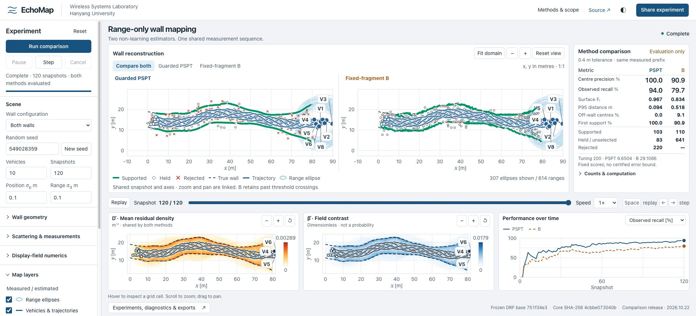
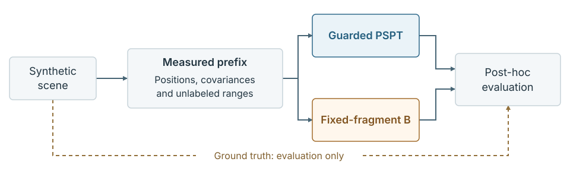

<div align="center">

# EchoMap

### Range-only wall mapping from collaborative bistatic echoes

A research workbench for seeing how measurements become surface hypotheses, and when those hypotheses remain ambiguous.

[](https://github.com/woqhrl9494-cell/corridor-mapper/actions/workflows/pages.yml)
[](https://woqhrl9494-cell.github.io/corridor-mapper/drf.html)
[](LICENSE)

[**Open the workbench**](https://woqhrl9494-cell.github.io/corridor-mapper/drf.html) · [**Comparison protocol**](THRESHOLD_PROTOCOL.md) · [**Reproduce locally**](#reproduce-locally)

</div>



*One synthetic scene, two causal estimators. The screenshot uses seed 549028359, 10 vehicles, 120 snapshots, and position/range SD 0.1 m. It illustrates the interface, not aggregate performance. [Replay these settings](https://woqhrl9494-cell.github.io/corridor-mapper/drf.html#v1=%7B%22vehicles%22%3A10%2C%22snapshots%22%3A120%2C%22sigmaP%22%3A0.1%2C%22sigmaD%22%3A0.1%2C%22seed%22%3A549028359%7D).*

EchoMap is developed by **Jaebok Lee, Wireless Systems Laboratory, Hanyang University**. It studies a question in collaborative sensing: can noisy, unlabeled path lengths distinguish a wall patch from a plausible geometric alternative?

The browser generates curved walls, vehicle motion, and specular/diffuse returns. Two non-learning estimators process the **same measured prefix**, while a separate evaluator measures agreement with simulated truth. Computation runs locally in Web Workers; no model service or training dataset is required to run an experiment.

## Explore the evidence

| Capability | What you can inspect |
|:--|:--|
| Compare two methods | Linked maps, common axes and snapshot, separate decisions and metrics |
| Inspect ambiguity | Supported, held and rejected hypotheses; B has no rejection decision |
| Replay the measurement history | Advance one snapshot, pause, replay, or inspect any completed prefix |
| Control the scene | 2–20 vehicles, 1–120 snapshots, one or two walls, position/range noise and scattering |
| Run paired sweeps | Both methods, fixed thresholds, current duration; mean and sample SD across seeds |
| Save the experiment | Shared settings URL, JSON with provenance, per-method CSV, 300 dpi field PNG |

The interface uses English labels, light and dark themes, equal spatial scales, and colour plus line/marker shape to distinguish layers. Camera changes affect presentation, not inferred geometry.

## Two estimators, one input contract

For transmitter position $p_i$, receiver position $p_j$ and a possible reflection point $s$, the ideal bistatic path length is

$$d = \lVert s-p_i\rVert_2 + \lVert s-p_j\rVert_2.$$

A single range defines an ellipse. Multiple measurements accumulate a **Direct Residual Field (DRF)**, from which each estimator proposes local surface candidates. A bright field peak is a proposal, not wall confirmation.

| | Guarded PSPT | Fixed-fragment B |
|:--|:--|:--|
| Representation | Local quadratic patches with mirror alternatives | Fixed 2 m straight fragments |
| Evidence | Four hypotheses: neither, original, mirror, both | Gaussian range evidence with competition between fragments |
| Geometry | Updated after predictive scoring | Fixed after proposal |
| Decision score | Current marginal log-odds, with geometry/evidence guards | Highest qualified Gaussian log-score reached so far |
| Fixed tuning threshold | **6.650397183049193** | **29.108623616301394** |
| Decisions | Supported / held / rejected | Supported / unselected |

PSPT means *Paired Surfel Predictive Test*. The two score scales are different and are not calibrated probabilities. The methods share measurements and a 100 × 100 candidate grid, but their models, state sizes and computational costs differ. Changing the display-field grid does not change their candidate grids.



The inference wire contains snapshot indices, measured 2D positions, reported pose covariances and unordered total path lengths with their reported range SDs. It excludes true walls, true poses, wall count/side, reflection labels, generator seeds and future observations. Candidate birth data are not reused as subsequent predictive evidence. [Inspect the wire contract](drf/wire.mjs).

## Know which experiment a number belongs to

The current operating points come from **exploratory tuning on 200 synthetic scenes**, not an independent test. They maximise observed-wall recall subject to empirical mean grouped-fragment FP ≤ 1% in that tuning set.

| Tuning-only result | Guarded PSPT | Fixed-fragment B |
|:--|--:|--:|
| Mean grouped-fragment FP | 0.992% | 0.792% |
| Mean observed-wall recall | 58.70% | 2.57% |
| Scenes with an empty estimate | 0% | 43.5% |

These are archived Python tuning aggregates, **not a fresh benchmark of the current browser release**. They used 3 vehicles, position SD 0 m, range SD 0.1 m, 120 snapshots and the earlier trajectory. Neither method simultaneously met the empirical FP ≤ 1% and recall ≥ 60% targets; neither has an LTT-certified error bound. B's low coverage at this threshold is part of the result.

The original 54-scene set was initially used for evaluation and later reused for development. Its old results must not be advertised as held-out evidence for the current method. It used 3 vehicles and position SD 0.1 m. Those two settings match the current **unshared defaults**, but do not describe the 10-vehicle example above, the 200-scene tuning distribution, or all current generator settings.

[Read the complete protocol and distribution differences](THRESHOLD_PROTOCOL.md) · [Inspect the tuning record and source hashes](validation/threshold-tuning-20261020.json) · [Read the historical study](PSPT_VALIDATION.md)

## Read the map and metrics

- **Supported** means sufficient measurement evidence under the method's model. It does not authenticate an echo source or guarantee a true wall.
- **Centre precision** is the fraction of supported centres within 0.4 m of a true wall. It is undefined for an empty estimate.
- **Observed recall** is the fraction of observed wall samples within 0.4 m of supported patches. A wall sample is observed if it lies within 1 m of a generated reflection point from the measured prefix.
- **Surface F₁** combines sampled-patch precision and observed recall. Overlapping patch samples count repeatedly in surface precision.
- **First support** records centre precision at each candidate's first support decision. Later corrections do not erase an earlier error.
- **P95 distance** and **off-wall centres** describe supported-centre error. They are not the grouped-fragment loss used for tuning.

D̄ is the mean residual density in m⁻². β̂ is a dimensionless field-contrast index, not a probability. True walls and reflection points are optional evaluation overlays. Supported patches are never snapped to true walls or joined across unsupported gaps.

## Run and share an experiment

1. [Open EchoMap](https://woqhrl9494-cell.github.io/corridor-mapper/drf.html), choose settings, and select **Run comparison**.
2. Use **Compare both** or enlarge either method. Replay completed snapshots to inspect when support first appears.
3. Open **Experiments, diagnostics & exports** for paired sweeps and post-hoc scattering diagnostics.
4. Choose **Share experiment** to copy a seeded settings URL, or download JSON/CSV to retain results.

Shared URLs preserve their seed and snapshot count on reload. An unseeded visit chooses a new seed. A URL shares settings, not computed outputs or an immutable software revision; retain the JSON and repository commit for a research record.

The layered wall spans x = 0–80 m. Vehicles advance ⅔ m in x per snapshot, so 120 snapshots cover 80 m from their initial positions. Physical time per snapshot is unspecified. Large fleets cost more: 10 vehicles produce 45 unordered pairs per snapshot. Use progress, pause and cancel rather than interpreting elapsed browser time as a method benchmark.

## Reproduce locally

The recorded development environment is **Node.js 26.7.0**. Install the pinned development dependencies, build the offline bundle, and run the full reference checks:

```sh
git clone https://github.com/woqhrl9494-cell/corridor-mapper.git
cd corridor-mapper
npm ci
npm run build:drf-offline
PSPT_FULL_PARITY=1 npm test
node build-pages.mjs
python3 -m http.server 8871 --bind 127.0.0.1 --directory _site
```

Open [localhost:8871/drf.html](http://127.0.0.1:8871/drf.html). For local-file use, open the repository's `drf.html` after rebuilding the offline bundle. Rebuild it whenever runtime sources change.

[Release verification record](validation/2026-10-22/protocol-audit.json).

The tests cover analytic geometry and likelihood cases, frozen Python checkpoints, causal prefixes, truth exclusion, paired sweep/export contracts, and bundle/deployment integrity. Historical SURF hash fixtures are platform sensitive; CI runs the full suite on macOS and the current DRF suite on Linux. Tests establish the properties they check, not physical-sensor performance or an error-rate guarantee. The 200-scene raw tuning archive is not bundled, so `npm test` does not regenerate its table.

## Scope and research limits

This is a **synthetic, measurement-level simulator**, not an RF waveform or hardware validation platform. The reported noise SDs match those used to generate observations. Controlled noise/model-mismatch experiments are not implemented; curved walls, finite patches and scattering can still differ from the estimators' assumptions.

Mirror ambiguity, insufficient noncollinear geometry and noisy pose information can leave candidates unresolved or produce false support. Two vehicles cannot pass PSPT's instantaneous noncollinearity guard. A high final precision can coexist with poor coverage, empty estimates or earlier false decisions. Current experiments provide no claim of robustness to unspecified mismatch, real cave performance or complete wall recovery.

## Source and evidence map

| Location | Purpose |
|:--|:--|
| [`drf.html`](drf.html), [`drf/`](drf/) | Current application, simulator, estimators and post-hoc evaluation |
| [`drf/comparison.mjs`](drf/comparison.mjs) | Executable method thresholds and provenance |
| [`THRESHOLD_PROTOCOL.md`](THRESHOLD_PROTOCOL.md) | Current selection rules, dataset roles and export definitions |
| [`tests/drf/`](tests/drf/) | Numerical, causal, integration and browser-support checks |
| [`PSPT_VALIDATION.md`](PSPT_VALIDATION.md) | Historical Python study and JavaScript port evidence |
| [`DRF_METHOD.md`](DRF_METHOD.md), [`DRF_VALIDATION.md`](DRF_VALIDATION.md) | Archived field-method evidence under older protocols |
| [`build-pages.mjs`](build-pages.mjs) | Runtime-only Pages package; excludes old pages and legacy peak evaluation |

For a reproducible issue, include the shared URL or JSON, repository commit, browser/OS, and first snapshot where the result differs from your expectation. Numerical counterexamples and clear reproduction steps are especially useful. [Report an issue](https://github.com/woqhrl9494-cell/corridor-mapper/issues).

If you use EchoMap in research, cite this repository with its commit hash and access date, and report the method thresholds, generator settings and evaluation definitions. A browser screenshot alone is not a reproducibility record.

## License

Copyright © 2026 Jaebok Lee, Hanyang University. **CC BY-NC-ND 4.0** applies; see [LICENSE](LICENSE) for terms and separate licensing contact details.
